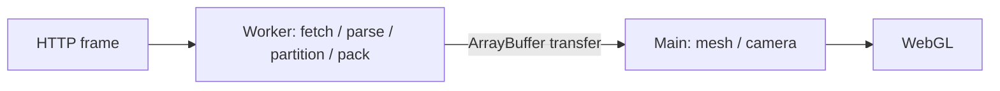

# クライアントのGaussian処理

時間モデルの連続再生は[temporal-playback](temporal-playback.md)、以下のフレーム取得・mesh交換は既存 `.splat` 列の時刻シークに適用する。

取得・parse・空間分割・packingをWeb Workerで行い、`ArrayBuffer`をtransferする。カメラ・mesh構築・GPU転送はmain threadに残す。

## 資源とキャンセル

| 対象 | 契約 |
| --- | --- |
| Worker | 1つを再利用、処理中1件。全時刻先読み・frame cacheなし |
| 保持 | 自由視点は1項目。初回は動画を残し、動画へ戻った同じ項目ではWorker/GPUを停止保持 |
| 取消 | 新seekで処理中Workerを終了し最新要求だけを処理。古いevent/job IDを無視。取消・移動・離脱・エラーで破棄 |
| 上限 | HTTP32MiB、準備buffer64MiB。Content-Length不在でも実bytesを数え、超過は再生エラー |
| 交換 | 準備中は旧sceneを操作可能。カメラ保存後、旧sceneを解放して追加。GPU変更を直列化し、画面30秒timeoutも同じ破棄経路 |

固定SDK GaussianSplats3D 0.4.7の `replaceExisting` は旧子要素保持と非同期tree競合をローカル再現したため使わない。`removeSplatScene` をawaitし、旧mesh/tree/sort workerを解放してから `addSplatBuffers` する。Workerも同じ固定parser/generator、alpha閾値1・float32を使い、追加量子化・間引きはしない。

## テクスチャの確保

SDKの最低高さ1024行をビルド時に1行へ変更する。幅4096・必要容量まで倍増する計算は維持する。0.4.7の対象sourceが1か所だけ一致する場合に適用し、版/source/bundle変更時はbuildを失敗させる。依存package自体は変更せず、Worker生成物とlicenseをWeb buildへ含める。

約19〜21万Gaussianのローカルsampleでは3種類のtexture backing data合計が144→16MiB。texture単独3組比較で固定カメラ/時刻の画素・decoded bufferは一致したが、logical ready短縮は確認できなかった。ブラウザ総メモリ・FPS・初回表示時間の改善を意味せず、ABR/実機評価は別途必要。

## 時間モデルの受信

RGS1 Workerは利用可能なContent-Lengthでbufferを確保しchunkを直接書く。body実数は常に32MiB上限。content codingで宣言長を超える場合・長さ不明時はbounded結合へ戻す。短いbodyはSHA確認前に正確な長さへ揃え、エラー/超過ではbodyをcancelしreaderを解放する。

5,816,150byteモデル・64KiB模擬chunkでは、chunk群+結合bufferを持つ約11.63MBの期間を事前確保buffer+処理中chunkへ置き換えた。明示payload保持量の比較で、browser/GPU peakではない。

Node 24.13.0・同一CPU core・暖機各1回・交互3回の受信/hash/復号/SDK準備中央値は98.0→104.7ms。短縮は確認できず、全6回のraw model/SDK buffer/motion/texture SHAは一致した。network・Worker起動・GPU/描画は対象外。4列復号案も短縮せずscratchを要したため不採用。形式・画質・転送bytesは変えない。

## 検証

`npm test --prefix apps/web/viewer` は固定SDKとのbyte一致、上限、再利用/取消/遅延event、最新seek、カメラ保持、旧scene解放、source変更検知を確認する。実browserでは実資産の描画一致・反復seek・離脱解放・動画切替を確認する。
