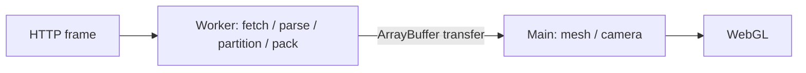

# クライアントのGaussian処理

自由視点には、時間モデルをGPUに保持する連続再生と、既存の`.splat`列を切り替える時刻シークの2経路がある。連続再生の形式・時間とカメラの同期・測定結果は[連続再生の設計](temporal-playback.md)に記載する。以下のフレーム取得・mesh交換は`.splat`列の経路に適用する。

自由視点の時刻切替では、必要な1フレームを取得し、描画用bufferへ変換する。ダウンロード・`.splat`のparse・空間分割・packingは専用のWeb Workerで行い、準備した`ArrayBuffer`をtransferしてメインスレッドへ渡す。メインスレッドにはカメラ操作・mesh構築・GPUへの転送を残す。

## 資源とキャンセル

- 準備用Workerは1つを再利用し、処理中の要求は1件とする。全時刻の先読み・フレームキャッシュは持たない。
- UIは同時に1項目だけの自由視点を保持する。初回は通常動画を表示したまま準備し、動画へ戻った後も同じ項目ではWorker・GPU資源を停止状態で保持する。準備のキャンセル・項目の移動・エラー時は破棄する。
- 新しい時刻が要求されたら、準備中のWorkerを終了し、最後の要求だけを進める。古いWorkerのイベントと古いjob IDは無視する。画面離脱でもWorkerを終了する。
- HTTP入力は32MiB、準備済みbufferは64MiBを上限とする。Content-Lengthがなくても、受信したbytesを数えて制限する。上限を超える資産は再生エラーとなるため、公開時に適合する表現を用意する。
- 準備中は前のシーンを操作できる。準備後にカメラを保存し、旧シーンを解放して新しいbufferを追加する。GPU資源の変更は直列化する。画面側の30秒timeoutでも既存の破棄処理を使う。

GaussianSplats3D 0.4.7の`replaceExisting`経路は、旧sceneの子要素保持と非同期tree構築の競合をローカルで再現したため使わない。公開APIの`removeSplatScene`をawaitし、旧mesh・tree・sort workerを解放してから`addSplatBuffers`する。

Workerもviewerと同じ固定版のparserとgeneratorを使う。alpha閾値1・float32の設定を維持し、追加の量子化やGaussianの間引きは行わない。

## テクスチャの確保

固定版SDKは、小さなシーンでもテクスチャの高さを最低1024行から確保する。ビルド時に初期高さだけ1行へ変更し、SDKの幅4096・必要容量まで2倍ずつ増やす計算を維持する。

この変更はSDK 0.4.7の対象ソースが1か所だけ一致する場合に限って適用する。版・ソース・bundle対象が変わった場合はビルドを失敗させ、再確認する。依存package自体は書き換えない。workerの生成物とライセンス表記もWebビルドへ含める。

ローカルの約19〜21万Gaussianのサンプルでは、3種類のテクスチャ用backing data合計が144MiBから16MiBとなった。これはブラウザ全体のメモリ量ではない。texture変更単独の3組の比較では、固定カメラ・時刻の画素とdecoded bufferが一致した一方、logical readyの短縮は確認していない。

Workerへの移動もCPU処理そのものをなくす変更ではない。mesh構築やGPU転送は残り、端末でのFPS・初回表示時間・総メモリ削減を保証するものではない。ABRとの接続と実機評価は別に行う。

## 時間モデルの受信

RGS1のWorkerは、利用可能なContent-Lengthを受信用bufferの確保に使い、届いたchunkを直接書き込む。実際のbodyは常に32MiBまで数える。HTTPのcontent codingでbodyが宣言長より大きくなる場合や長さが不明な場合は、従来と同じboundedな結合処理へ戻す。短いbodyには余分なゼロを付けず、SHA確認前に正確な長さへ揃える。応答エラーや上限超過ではbodyをcancelし、readerを解放する。

既存の5,816,150byteモデルと64KiBの模擬chunkでは、元chunk群と結合済みbufferを同時に保持する約11.63MBの期間を、事前確保bufferと処理中chunkの保持へ置き換える。これは受信処理の明示的なpayload保持量の比較であり、ブラウザ全体やGPUを含むpeak memoryの削減量ではない。

Node 24.13.0・同一CPU core・暖機1回ずつ・交互3回で、受信/hash/復号/SDK準備の合計中央値は変更前98.0ms、変更後104.7msだった。CPU時間の短縮は確認していない。全6回でraw model・SDK buffer・motion・textureのSHAが一致した。ネットワーク・Worker起動・GPU転送・実描画はこの測定に含まない。4列単位の復号案も全体の短縮が確認できず、追加scratch bufferが必要なため採用しなかった。

この変更は受信中の一時buffer保持を抑えるもので、圧縮形式・画質・転送bytesは変えない。実回線と端末での表示時間は別途確認する。

## 検証

`npm test --prefix apps/web/viewer`で、固定SDKの変換とのbyte一致、入力サイズ制限、Worker再利用・取消・遅延イベント、最新seekへの集約、カメラ保持、旧sceneの解放、依存ソースの変更検知を確認する。実ブラウザでは、実資産を使った描画の一致、繰り返しシーク、離脱時の解放、動画との切替を確認する。
