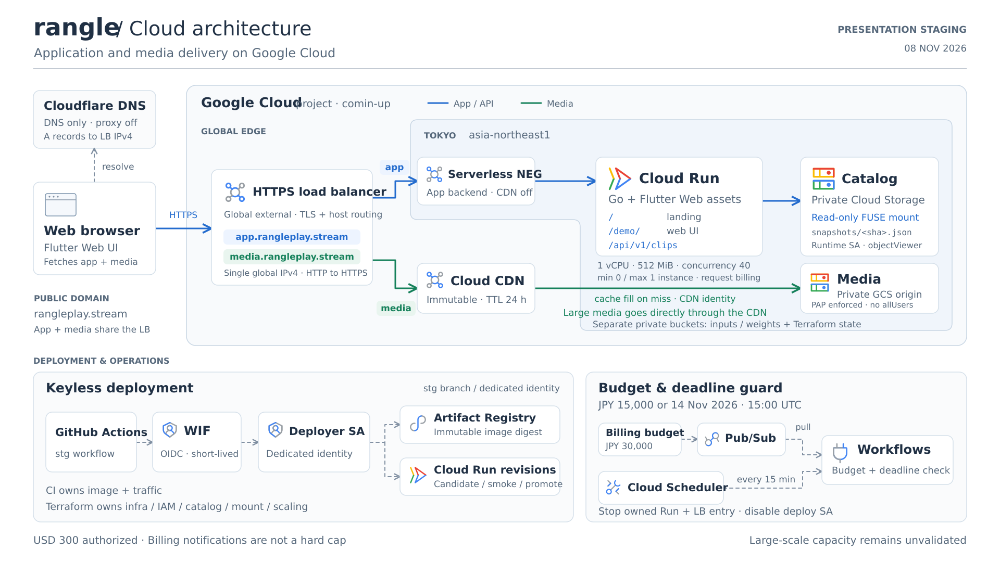
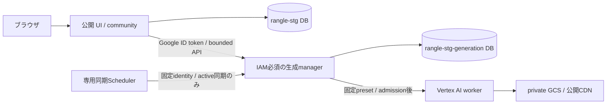

# rangle のクラウド構成

2026-11-08に構築した発表用stgの配信経路と、生成制御を分離した現在のコード上の構成を示す。正本は [Terraform](../infra/gcp/modules/presentation/) と [配備手順](stg-deployment.md)。生成managerの実適用・データ移行・疎通の完了は、配備記録で別に確認する。逐次GPU生成の実測は[クラウドLIVE](cloud-live.md)を参照。



[SVGを開く](diagrams/cloud-architecture.svg) · [発表用PNGを開く](diagrams/cloud-architecture.png)

## 配信経路

- **アプリ**：ブラウザ → `app.rangleplay.stream` → global external HTTPS Application Load Balancer → Tokyo の serverless NEG → Cloud Run `rangle-stg`。Go が `/` の landing、`/demo/` の Flutter Web、`/api/v1/clips` の API を配信する。app backend の CDN は無効。
- **メディア**：同じ LB の `media.rangleplay.stream` → Cloud CDN → private GCS media。公開許諾済みの不変 bytes を CDN からブラウザへ直接配信し、大容量 media を Go に中継させない。TTL は24時間。media bucket は PAP enforced / `allUsers` なしで、CDN の cache-fill service account に objectViewer を付与する。
- **カタログ**：Cloud Run の runtime SA が専用 private GCS catalog を read-only FUSE mount し、`/mnt/catalog/snapshots/<sha256>.json` を読む。入力・重み用の inputs と Terraform state は公開 media と別の private bucket に保持する。
- **DNS**：Cloudflare の app / media A record は Google LB の global IPv4 を返す **DNS only** 設定。ブラウザの HTTP 通信は Google の LB へ直接接続する。[Cloudflare proxy status](https://developers.cloudflare.com/dns/proxy-status/)

公開Cloud Run `rangle-stg` は `asia-northeast1`、1 vCPU / 512 MiB、request billing、min 0 / max 1、concurrency 40。発表用の小さい設定で、10万人同時視聴の容量実証は行っていない。コード上は `internal-and-cloud-load-balancing` ingressとし、外部からの既定 `run.app` / candidate-tag URLの直通を拒否する。CIはappのLB URLと候補headerを使って未昇格revisionを検証する。実環境への切替・再疎通は[配備手順](stg-deployment.md#lb入口制限への切替)に従い、実施前は適用済みと扱わない。

## 生成制御とデータの分離

上のSVGは配信・配備経路を表す。生成制御では、公開アプリと同じimageを別mode・別SAのCloud Run `rangle-stg-generation` として動かす。



| 実行identity | 許可するデータ・操作 |
| --- | --- |
| 公開 `rangle-stg-runtime` SA | `rangle-stg` DBのcommunity CRUD、private catalog read、managerのinvoke。生成DB・Vertex CustomJob・trainer actAsは持たない |
| private `rangle-stg-generation` SA | `rangle-stg-generation` DBの生成台帳CRUD、private catalog/config read、期限付きVertex操作と専用trainer actAs。community DBは読まない |
| 専用同期SA | managerの同期endpointをinvoke。DB・Vertex権限は持たない |

managerのingressは `all` だがCloud Run IAM認証を必須とし、公開UIのLB経路には載せない。呼出しを許可するのは公開runtime、専用同期SA、配備用SA。配備用SAはhealth確認とimage/traffic更新を担い、managerの業務APIは独立した署名・identity検証で拒否する。公開runtimeの署名付きservice tokenはapplication headerでも検証し、Cloud Runがplatform headerを書き換えても認証を省略しない。

公開runtimeでadmin cookie・現在のaccount role・CSRFを確認し、managerへowner IDを転送する。managerはownerを転送するruntime自体を信頼するため、公開runtimeのRCEはownerの偽装と残る枠内の正規preset操作まで可能である。manager側の同時1件・最大10 attempts・30分・固定spec・deadlineは迂回できず、台帳のresetや任意Vertex specの送信はできない。公開フィード・detail・engagementの存在確認もmanager経由で行い、private job設定を返さない。[生成API](generation.md)、[生成基盤](generation-infrastructure.md)

旧DBからの切替は、writersを停止して2つの生成collectionだけを型・ID・使用済みattempt・履歴・掲載状態ごと移し、照合後に再開する。データの正本を空のDBや古いsnapshotへ戻さない。[移行・復帰の契約](security-generation-migration.md)

## 配備と停止

GitHub Actionsの `stg` workflowはOIDC / Workload Identity Federationを経て専用deployer SAを使用する。長期SA keyを使わずArtifact Registryへimageを格納する。remote生成構成では、既存managerのidentity・config・IAMを検証し、認証付きcandidate healthとrevisionを確認してからmanagerを昇格する。その後、公開アプリのLB経由candidateを検証・昇格する。後続の失敗では両serviceの元の明示traffic配分へ復帰し、DBとIAMは巻き戻さない。[CI/CD](cicd.md)

| 所有者 | 管理するもの |
| --- | --- |
| Terraform | infrastructure、IAM、catalog SHA、mount、runtime args、scaling |
| CI | container image と revision traffic |

承認済み総予算は **USD 300**。専用の JPY 30,000 budget が Pub/Sub へ通知し、Cloud Scheduler が15分ごとに Workflows を起動する。Workflow は通知の額と期限を確認し、**JPY 15,000 または 2026-11-14 15:00 UTC（11月15日00:00 JST）**で専用 deployer SA を無効化し、owned Cloud Run・LB forwarding rules を削除、専用 global IP を解放する。成功後に private inputs へ receipt を残し、Scheduler を pause する。private data / state / Artifact Registry は保持する。

請求通知の遅延・確認間隔・保存費用があるため、これは総額の厳密な hard cap ではない。既存の Cloud Run 200円 spend cap も維持し、先に作動する可能性がある。停止の詳細と実 IAM の制約は [stg 配備手順](stg-deployment.md#予算期限の停止) を参照。

## 検証の到達点

Cloud Run / NEG / LB / Cloud CDN / private GCS は作成済み。app / mediaの独自ドメインでHTTPS接続、UI・API、mediaのRange・CORS・ETag・実ファイルのハッシュ一致と、GitHub WIF経由の配備を確認済み。図は配信・配備の構成を表し、配備状況の更新先は [配備手順](stg-deployment.md#検証と到達点)。

guard は期限前の `stopped=false / reason=not_due`、Scheduler による起動、費用0円の検証通知の decode・閾値判定・ack を確認済み。予算・期限到達時に資源を削除する分岐と、その実 IAM は未検証。実際の到達点の更新先は [stg 配備手順](stg-deployment.md#検証と到達点)。

## 図の再生成

SVG は1920×1080、PNG は3840×2160。文字・線・図形・公式アイコンのパスを含む SVG で、スクリーンショットではない。生成元にアイコンを埋め込んでいるためネットワーク接続は不要。

```bash
python3 docs/diagrams/cloud-architecture.py
# PNGも更新する場合（CairoSVG 2.9.1が必要）
python3 docs/diagrams/cloud-architecture.py --png
```

Google の [公式アイコン](https://cloud.google.com/icons) と [製品アイコンガイド（2026年5月版）](https://services.google.com/fh/files/misc/google-cloud-product-icons.pdf) を使用。アイコン・商標は Google LLC に帰属する。

## GCP向けスキルの確認

Google 公式の [google-cloud-solution-architecture](https://github.com/google/skills/tree/e2071e8c958792b9d03d5839fe885b0171ffeaee/skills/cloud/google-cloud-solution-architecture) を調査した。新規構成の要件整理・設計・検証を扱うスキルで、今回は既存構成の図示のためインストールせず、公式の製品資料とアイコンを参照した。

## 参照した一次資料

- [Global external ALB と serverless NEG](https://docs.cloud.google.com/load-balancing/docs/https/setup-global-ext-https-serverless)
- [Cloud CDN の backend bucket / private origin](https://docs.cloud.google.com/cdn/docs/setting-up-cdn-with-bucket#make_your_cloud_storage_bucket_private)
- [Cloud Run の Cloud Storage mount](https://docs.cloud.google.com/run/docs/configuring/services/cloud-storage-volume-mounts)
- [Deployment pipelines の WIF](https://docs.cloud.google.com/iam/docs/workload-identity-federation-with-deployment-pipelines)
- [Cloud Billing の Pub/Sub 通知](https://docs.cloud.google.com/billing/docs/how-to/budgets-programmatic-notifications)
