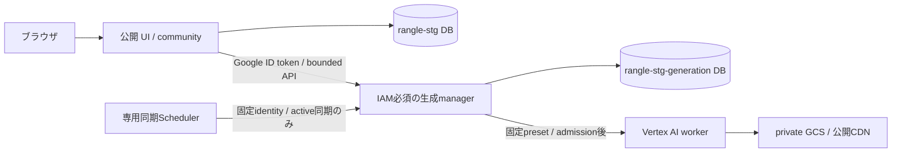

# rangle のクラウド構成

発表用stgを、全体・ML・配信・ログ監視の4図で示す。code・IaCは `origin/stg`（`b657874`）に基づき、2026-11-10 JSTのLB入口制限・ログ基盤と、生成manager・DB分離・Cloud Armorの[配備記録](security-review.md)を反映する。全資源の最新状態を網羅的に再照会した図ではない。正本は `infra/gcp/environments/presentation` → [presentation module](../infra/gcp/modules/presentation/) と [配備手順](stg-deployment.md)。汎用stgのplatform moduleとは別の構成である。

| 図 | 読み取ること | 実装の入口 |
| --- | --- | --- |
| [全体構成を開く](diagrams/overview.html) | Flutter Web、Go API、Google Cloud上の有限GPU生成、CDN、CI/CDと横断するログ監視・運用 | [Goの接続](../cmd/rangle-server/application.go)、[LBとCDN](../infra/gcp/modules/presentation/edge.tf)、[ログ監視](../infra/gcp/modules/presentation/observability.tf) |
| [ML処理を開く](diagrams/ml-pipeline.html) | 公開側の認証とIAM必須manager、生成専用台帳、NPZ/bundle、offlineとliveの分岐、検証・公開の出口 | [生成制御](../internal/generation/manager.go)、[CustomJob](../internal/generation/vertex.go)、[offline worker](../ml/rangle_training/train.py)、[live worker](../ml/rangle_live/cloud.py) |
| [配信処理を開く](diagrams/delivery.html) | feed/manifest・LIVE indexと、不変資産の取得、Worker復号・WebGL描画 | [LIVE配信契約](live-streaming.md)、[JS viewer](../apps/web/viewer/src/session.js)、[Worker](../apps/web/viewer/src/temporal-worker.js) |
| [ログ監視を開く](diagrams/observability.html) | 4種のログ収集元、専用sink・30日保持、同じviewでの検索、ログと別経路の標準メトリクス | [監視IaC](../infra/gcp/modules/presentation/observability.tf)、[運用・検証記録](observability.md) |

各HTMLはアイコン・日本語フォントを内包する。全体・ML・配信図では、青実線はHTTP・モデルデータ、灰実線は制御・メタデータ、破線はCI/CD。全体図のHTTP双方向矢印は要求と応答、点線はログ・標準メトリクスを示す。ログ監視図では青がログ、灰が標準メトリクスを示す。PNGはこのHTMLからlight/darkの両方を生成する。[再生成・出典](diagrams/README.md)

図は実装・設定による接続を示し、すべての機能が無条件で有効になるという意味ではない。生成は不変configのSHA、LIVEは専用設定とfeature flagを使って有効にする。[生成基盤](generation-infrastructure.md)と[クラウドLIVEの配備条件](cloud-live.md#権限と配備)を参照。

- GPUはVertex AI CustomJobのTokyo Spot T4×1。Cloud RunはCPUのUI/API・生成制御であり、常駐GPUや独立したGCE workerを採用した図ではない。
- 入力は承認済みの校正・同期済み複数カメラ録画とseed。任意の単眼uploadやRTMP/RTSP受信は含まない。liveでは録画を元のPTSで供給し、到着した画像だけで更新する。提供seed・校正は事前情報を含む。
- クライアントはFlutter **Web**とJS iframe viewer。native mobileの実装・端末性能や大規模同時視聴を示すものではない。ABR・差分codecをこの配信経路へ追加した図でもない。
- 実GPUで入力→逐次生成→CDN公開は確認済みだが、**30秒の遅延を継続して満たす目標は未達**。起動待ち・画質・破棄window・測定範囲は[実測](cloud-live.md#2026-11-09の実gpu検証)を参照する。

LIVEの処理待ちは最新window 1件で、評価4視点の画素は学習から除外する。配信側も待ち更新を最新1件にまとめ、新モデルの準備中は旧モデルと視点を保持する。通常のpreview動画はFlutter側の別経路で再生し、Goは大容量モデルを中継しない。

## ネットワーク境界とアクセス制御

全体図のGoogle Cloud枠はサービスの所属を示し、VPCやprivate subnetの境界ではない。presentation構成には利用者が指定するVPC・subnetwork・subnet CIDRがなく、Vertex CustomJobにも`Network`を指定していない。Cloud RunはVPC connector・Direct VPC interfacesともに未設定。図中の「Google管理」はこれらのmanaged serviceを表し、利用者専用のprivate subnetが存在するという意味ではない。

| 対象 | 到達経路と制御 |
| --- | --- |
| LBの公開VIP | `34.96.101.8/32`。**単一hostの公開IP**をCIDR表記したもので、VPC subnetのCIDRではない。app / mediaのDNS A recordは2026-11-09 16:56 UTCにこのIPを確認 |
| Cloud Run / UI・API | `internal-and-cloud-load-balancing` ingress。外部HTTPの入口はLBに統一し、既定`run.app`とcandidate-tag URLへの外部直通は404を確認。Cloud Runのinvoker IAMチェック無効（操作認可はGo）、default URI自体は有効。CIのsmokeもappのLB URLと候補headerを使う |
| Cloud Run / 生成manager | `ingress=ALL`、Cloud Run IAM認証必須。公開UIのLB経路に載せず、許可したruntime・同期SA・配備SAから呼ぶ。業務APIは署名付きidentityも検証する。公開runtimeは生成DB・Vertexを直接操作しない |
| GCS inputs / catalog | PAP enforcedとIAMで保護。入力・設定・目録を匿名公開しない。Go runtimeやtrainerには用途別の権限を与える |
| GCS media / Cloud CDN | bucket自体はPAP enforced / IAM保護。cache-fill identityが読み、**許諾済み素材だけをCDNの公開HTTPSで配信**する。入力bucketをCDN originへ流用しない |
| Firestore / Vertex / Artifact Registry | Goの実行台帳・アカウント、job制御、image取得はIAMで制御。ネットワーク上のprivate subnetによる隔離を示したものではない |

公開HTTPS入口があることと、すべてのデータを匿名で取得できることは別である。公開feed・mediaの閲覧に対し、生成・交流の操作はGoの認証、CSRF保護、管理者・所有者判定を使う。[受付の実装](../internal/generation/handler.go)・[アプリの接続](../cmd/rangle-server/application.go)・[IAM](generation-infrastructure.md)を参照。今回の図更新はネットワーク制限の追加やsecurity設定の変更を含まない。

入口制限は [#116](https://github.com/Hosi121/rangle/pull/116) のIaCを2026-11-10 JSTに適用済み。WIFによるrevision・tag・trafficの操作はGoogleの制御API経由、候補のHTTP検証はLB経由である。図の下段のCI矢印は制御APIを表す。候補headerは経路の選択に使い、Goの操作認可とは別である。

## ログ監視の経路と到達点

全体図にもCloud Logging・Cloud Monitoring・Scheduler/Workflowsと収集元の接続を示す。点線は観測データの経路で、LB→Cloud RunやCDN→Storageの要求・モデル配信と分けて読む。sinkの収集条件、既存の保存先、検索viewなどの詳細はログ監視図で示す。

[ログ監視図](diagrams/observability.html)は、Cloud Run、VertexのPython worker、LB/CDN、Scheduler/WorkflowsのログをCloud Loggingの専用sinkで選択し、同一projectのLogging bucket `rangle-stg-logs` にコピーする構成を示す。このバケットはCloud Storageのmedia・inputsとは別の資源で、Tokyo・保持30日。監査ログは専用sinkから除外し、既存 `_Default` / `_Required` のrouting・保持期間は変更しない。

Cloud Monitoringの5つのログパネルとLogs Explorerは、専用バケットの同じ `_AllLogs` viewを読む。要求数/秒とrevision別p95の2つのグラフはCloud Runの標準メトリクスを使い、ログバケットや独自のログベース指標を経由しない。p95はUI・health・APIを含むサービス側の要求時間で、ブラウザ描画時間ではない。説明を含めダッシュボードは8 widgetsで、既存IAMにより閲覧する。

ログ基盤は適用済みで、専用viewへのCloud Run・CDN・生成同期Schedulerの到達と、標準メトリクスの実データを確認した。generation有効時は公開UI/APIと生成managerの両ログを集め、標準メトリクスのグラフは公開Runだけを対象にする。MLは既存実ログの `jsonPayload.service` を収集条件に使うが、適用後の新しいGPU jobは実行していない。app/candidateのLB要求ログは既存の10% samplingを保ち、通知・SLO・ブラウザ計測は追加していない。初回配備時のimage未更新の記録と、その後のmanager・公開runtime切替の記録は、[ログ監視](observability.md)と[配備記録](security-review.md)を参照する。

## 旧配備図（2026-11-08）

以下は初期の配信・配備図として保持する。ML生成とLIVEの更新・ログ監視を含まないため、現在の全体説明には上の4図を使う。


[SVGを開く](diagrams/cloud-architecture.svg) · [発表用PNGを開く](diagrams/cloud-architecture.png)

## 配信経路

- **アプリ**：ブラウザ → `app.rangleplay.stream` → global external HTTPS Application Load Balancer → Tokyo の serverless NEG → Cloud Run `rangle-stg`。Go が `/` の landing、`/demo/` の Flutter Web、`/api/v1/clips` の API を配信する。app backend の CDN は無効。
- **メディア**：同じ LB の `media.rangleplay.stream` → Cloud CDN → private GCS media。公開許諾済みの不変 bytes を CDN からブラウザへ直接配信し、大容量 media を Go に中継させない。TTL は24時間。media bucket は PAP enforced / `allUsers` なしで、CDN の cache-fill service account に objectViewer を付与する。
- **カタログ**：Cloud Run の runtime SA が専用 private GCS catalog を read-only FUSE mount し、`/mnt/catalog/snapshots/<sha256>.json` を読む。入力・重み用の inputs と Terraform state は公開 media と別の private bucket に保持する。
- **DNS**：Cloudflare の app / media A record は Google LB の global IPv4 を返す **DNS only** 設定。ブラウザの HTTP 通信は Google の LB へ直接接続する。[Cloudflare proxy status](https://developers.cloudflare.com/dns/proxy-status/)

Cloud Run は `asia-northeast1`、1 vCPU / 512 MiB、request billing、min 0 / max 1、concurrency 40。発表用の小さい設定で、10万人同時視聴の容量実証は行っていない。`internal-and-cloud-load-balancing` ingressは実環境にも適用し、LBからのHTTP 200と既定 `run.app` / candidate-tag URLへの外部直通404を確認した。CIはappのLB URLと候補headerを使って未昇格revisionを検証する。切替手順は[配備手順](stg-deployment.md#lb入口制限への切替)を参照する。

## 生成制御とデータの分離

上のSVGは配信・配備経路を表す。生成制御では、公開アプリと同じimageを別mode・別SAのCloud Run `rangle-stg-generation` として動かす。



| 実行identity | 許可するデータ・操作 |
| --- | --- |
| 公開 `rangle-stg-runtime` SA | `rangle-stg` DBのcommunity CRUD、private catalog read、managerのinvoke。生成DB・Vertex CustomJob・trainer actAsは持たない |
| private `rangle-stg-generation` SA | `rangle-stg-generation` DBの生成台帳CRUD、private catalog/config read、期限付きVertex操作と専用trainer actAs。community DBは読まない |
| 専用同期SA | managerの同期endpointをinvoke。DB・Vertex権限は持たない |

managerのingressは `all` だがCloud Run IAM認証を必須とし、公開UIのLB経路には載せない。呼出しを許可するのは公開runtime、専用同期SA、配備用SA。配備用SAはhealth確認とimage/traffic更新を担い、managerの業務APIは独立した署名・identity検証で拒否する。公開runtimeの署名付きservice tokenはapplication headerでも検証し、Cloud Runがplatform headerを書き換えても認証を省略しない。

公開runtimeでadmin cookie・現在のaccount role・CSRFを確認し、managerへowner IDを転送する。managerはownerを転送するruntime自体を信頼するため、公開runtimeのRCEはownerの偽装と残る枠内の正規preset操作まで可能である。manager側の同時1件・最大10 attempts・30分・固定spec・deadlineは迂回できず、台帳のresetや任意Vertex specの送信はできない。公開フィード・detail・engagementの存在確認もmanager経由で行い、private job設定を返さない。[生成API](generation.md)、[生成基盤](generation-infrastructure.md)

旧DBからの切替は、writersを停止して2つの生成collectionだけを型・ID・使用済みattempt・履歴・掲載状態ごと移し、照合後に再開する。データの正本を空のDBや古いsnapshotへ戻さない。[移行・復帰の契約](security-generation-migration.md)

## 配備と停止

GitHub Actionsの `stg` workflowはOIDC / Workload Identity Federationを経て専用deployer SAを使用する。長期SA keyを使わずArtifact Registryへimageを格納する。remote生成構成では、既存managerのidentity・config・IAMを検証し、認証付きcandidate healthとrevisionを確認してからmanagerを昇格する。その後、公開アプリのLB経由candidateを検証・昇格する。後続の失敗では両serviceの元の明示traffic配分へ復帰し、DBとIAMは巻き戻さない。[CI/CD](cicd.md)

| 所有者 | 管理するもの |
| --- | --- |
| Terraform | infrastructure、IAM、catalog SHA、mount、runtime args、scaling |
| CI | container image と revision traffic |

承認済み総予算は **USD 300**。専用の JPY 30,000 budget が Pub/Sub へ通知し、Cloud Scheduler が15分ごとに Workflows を起動する。Workflow は通知の額と期限を確認し、**JPY 15,000 または 2026-11-14 15:00 UTC（11月15日00:00 JST）**で専用 deployer SA を無効化し、owned Cloud Run・LB forwarding rules を削除、専用 global IP を解放する。成功後に private inputs へ receipt を残し、Scheduler を pause する。private data / state / Artifact Registry は保持する。

請求通知の遅延・確認間隔・保存費用があるため、これは総額の厳密な hard cap ではない。既存の Cloud Run 200円 spend cap も維持し、先に作動する可能性がある。停止の詳細と実 IAM の制約は [stg 配備手順](stg-deployment.md#予算期限の停止) を参照。

## 検証の到達点

Cloud Run / NEG / LB / Cloud CDN / private GCS は作成済み。app / mediaの独自ドメインでHTTPS接続、UI・API、mediaのRange・CORS・ETag・実ファイルのハッシュ一致と、GitHub WIF経由の配備を確認済み。図は配信・配備の構成を表し、配備状況の更新先は [配備手順](stg-deployment.md#検証と到達点)。

guard は期限前の `stopped=false / reason=not_due`、Scheduler による起動、費用0円の検証通知の decode・閾値判定・ack を確認済み。予算・期限到達時に資源を削除する分岐と、その実 IAM は未検証。実際の到達点の更新先は [stg 配備手順](stg-deployment.md#検証と到達点)。

## 旧配備図の再生成

SVG は1920×1080、PNG は3840×2160。文字・線・図形・公式アイコンのパスを含む SVG で、スクリーンショットではない。生成元にアイコンを埋め込んでいるためネットワーク接続は不要。

```bash
python3 docs/diagrams/cloud-architecture.py
# PNGも更新する場合（CairoSVG 2.9.1が必要）
python3 docs/diagrams/cloud-architecture.py --png
```

Google の [公式アイコン](https://cloud.google.com/icons) と [製品アイコンガイド（2026年5月版）](https://services.google.com/fh/files/misc/google-cloud-product-icons.pdf) を使用。アイコン・商標は Google LLC に帰属する。新しい4図の再生成は[別手順](diagrams/README.md)を使う。

## GCP向けスキルの確認

Google 公式の [google-cloud-solution-architecture](https://github.com/google/skills/tree/e2071e8c958792b9d03d5839fe885b0171ffeaee/skills/cloud/google-cloud-solution-architecture) を調査した。新規構成の要件整理・設計・検証を扱うスキルで、今回は既存構成の図示のためインストールせず、公式の製品資料とアイコンを参照した。

## 参照した一次資料

- [Global external ALB と serverless NEG](https://docs.cloud.google.com/load-balancing/docs/https/setup-global-ext-https-serverless)
- [Cloud CDN の backend bucket / private origin](https://docs.cloud.google.com/cdn/docs/setting-up-cdn-with-bucket#make_your_cloud_storage_bucket_private)
- [Cloud Run の Cloud Storage mount](https://docs.cloud.google.com/run/docs/configuring/services/cloud-storage-volume-mounts)
- [Deployment pipelines の WIF](https://docs.cloud.google.com/iam/docs/workload-identity-federation-with-deployment-pipelines)
- [Cloud Billing の Pub/Sub 通知](https://docs.cloud.google.com/billing/docs/how-to/budgets-programmatic-notifications)
