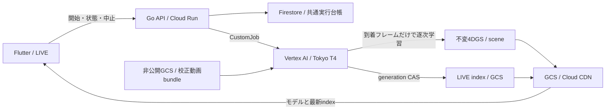

# クラウドGPUによるライブ自由視点生成

到着した校正済み複数カメラ映像で4DGSを更新し、モデルができた順にCDNへ公開する。現在の入力はVRU Basketball gzの録画動画を元のPTSに合わせて供給する10秒のテスト。実カメラのRTMP/RTSP受信は今回の経路に含まない。

## 実行と停止

既存の `POST /api/v1/generation/jobs` に承認済み `mode: live` のpreset IDとrequest IDを送る。認証・所有者確認・再送時の同一job ID・状態取得・中止は既存生成APIを共用する。レスポンスの `viewer_url` は受付時から `/demo/?live=<job ID>`。LIVEの生成結果を `generated-<id>` のVODとして掲載する操作は受け付けない。

静的生成・動的生成・ライブ生成は **同じFirestore台帳** を使う。TokyoのSpot T4×1、offlineはn1-standard-4／liveはn1-standard-16、worker×1、30分、provider設定を `disableRetries=true` に固定し、累計10 attemptsの予約枠を共有する。失敗や中止でattemptを返金しない。Vertexのキュー待ちとimage取得を含めた絶対期限もworkerへ渡す。既存Schedulerの状態同期と期限・予算停止guardが同じjob labelsでライブも扱う。

GPUは開始要求ごとのCustomJobで、常駐サービスは作らない。Spot中断やGPU不足は失敗として表示し、別リージョン・別GPU・新しいattemptへ自動で切り替えない。同一jobのcontainer再起動を実証中に観測したため、入力取得前に `live/snapshots/<session>/producer.json` をcreate-onlyでclaimし、2回目のproducer開始は拒否する。captureの原点を作り直して同じ公開sessionへ上書きしない。30秒という目標は **入力開始後の遅延**。GPUの確保・image取得・入力取得・kernel warmupを含む起動待ちは別に計測し、低遅延の保証には含めない。

## データと配信

`ml/rangle_live/bundle.py` が校正・seed・動画・manifestだけをchecksummed ZIPへまとめる。圧縮前後1GiB、256 filesを上限とし、展開時にはpath traversal、symlink、重複、未承認member、各SHA/size不一致を拒否する。bundleはprivate inputsの `datasets/live/` に非上書き配置する。元動画や評価画像は公開しない。

GPU workerはADCで取得し、元PTSまで待ってdecodeする。待機学習windowは最大1件で、遅れたら古いwindowを捨てる。Gaussianとoptimizerの状態を保持し、到着済みの画像だけで更新する。作者提供の校正と初期点群には事前情報があるため、幾何情報まで完全に因果的とは主張しない。学習・画質の制約は[ライブ学習](live-training.md)を参照。

モデルは既存RGS1のfloat欄・packingと可逆圧縮を維持し、今回の接続に量子化や追加間引きは加えない。Go validatorがscene・hash・time range・camera・出典を検証し、`live/<session>/<sequence>-<hash>/` の不変モデルとsceneを先に配置する。実CDNのbytesを確認してから、公開 `live-index/<session>.json` と非公開 `live/index.json` をgeneration CASで更新する。他sessionを消さず、sequenceの巻き戻しや同じモデルrevisionの変更を拒否する。

[GCSは同一object名への書き込みが毎秒1回まで](https://docs.cloud.google.com/storage/quotas#objects)。workerは公開成功後1.25秒待ち、その間のlocal index変更は最新1件へ集約する。通常・終了・異常終了で同じpacingを使う。429はGETか `ifGenerationMatch` 付きPOSTだけを同じbody/CAS条件で最大4試行し、絶対期限内でbackoffする。無条件POSTを盲目的に再送しない。

公開indexのCDN TTLは1秒、モデルは不変URLで長期cacheする。Flutterは最新indexをpollし、既存viewer内のモデルを交換する。前モデルと視点を保持し、iframeの再読み込みで更新しない。[配信契約](live-streaming.md)

## 権限と配備

既存configへoptionalな `live: {image, service_account, catalog_bucket}` を追加する。imageは同一project・TokyoのArtifact Registry digestを固定し、既存offline trainerのimageとidentityは変更しない。

Terraformの `application.generation_live_enabled` は既定false。生成configと `live_streaming_enabled` がある場合だけ有効にできる。専用 `rangle-stg-live-trainer` は入力の `datasets/live/` をget、不変のmedia `live/` とcatalog `live/snapshots/` をget/create、可変のmedia `live-index/` とcatalogの厳密な `live/index.json` だけをget/create/deleteできる。[上書きinsertにdeleteが必要](https://docs.cloud.google.com/storage/docs/json_api/v1/objects/insert)なため可変pointerだけに限定する。すべて発表期限までの条件付きで、bucket全体のlist・任意モデル削除・Firestore・IAM変更は渡さない。実装と権限根拠は[生成基盤](generation-infrastructure.md)と `infra/gcp/modules/presentation/generation-live.tf`。

ML imageは `docker build --platform=linux/amd64 --target live-trainer -f ml/Dockerfile .` でbuildする。digest固定のTorch 2.6/CUDA 12.4、build時にcompileしたT4用gsplat、hash固定のOpenCV、multi-stageでbuildしたGo validatorを使う。最後/defaultのoffline `trainer` targetは従来互換。cloud workerは `gcloud` や利用者tokenを使わない。

配備順は対応Go/UIとworker image、入力bundle、限定IAM、immutable生成config、config SHAの選択、candidate検証・traffic切替。実GPU検証は必ず受付APIを通し、直接CustomJobを作って台帳を迂回しない。入力からCDN公開、複数snapshot、terminalとactive枠解放までを確認する。

初回に新規custom roleの作成直後だけGCS IAMが `Role ... does not exist in the resource's hierarchy` を返す場合がある。成功済みresourceはstateへ残す。roleの存在とprojectを確認し、伝播後に再planして残ったIAMだけをapplyする。既成の広いstorage roleへの置換やstate/台帳の初期化で回避しない。

ライブのCPUは34カメラの元動画復号向けに16 vCPU、decoderは16並列とする。GPUはT4一枚を維持する。[公式対応表](https://docs.cloud.google.com/vertex-ai/docs/training/configure-compute#GPUs)で32 vCPUはT4が2枚以上必要なため採用しない。offline生成は4 vCPUを維持する。公開Tokyo Training通常価格による16 vCPU＋T4＋100GiB diskの30分比較額は約USD0.78で、既存USD2/attemptの予約枠内という設計。Spot管理費・cleanup・実請求の厳密なhard capを証明した値ではない。[価格](https://cloud.google.com/vertex-ai/pricing)

## 2026-11-09の実GPU検証

既存の認証付き受付APIから起動した。VRU Basketball gzの同じ34カメラ・10秒・25fps、学習480×270、30学習視点と4評価視点、作者の初期点群、1 windowあたり300更新を維持した。入力bundleはSHA256 `133e9afdc4caded541dd4040d4caf0cf442ffdfa71c3c4b161eabbc343aef50b`、783,744,881 bytes。元動画は1920×1080のHEVCであり、低解像度学習でも元動画の復号費用がある。

| 測定 | 初回・4 vCPU | 現設定・16 vCPU＋公開pacing |
| --- | ---: | ---: |
| 入力開始→最初のモデルを実HTTP確認 | 53.62秒 | 30.88秒 |
| 各window終端→実HTTP確認の平均／最大 | 139.07／220.77秒 | 48.15／63.04秒 |
| 10秒分の入力を受信し終えるまで | 223.20秒 | 64.31秒 |
| 公開モデル数／破棄window数 | 13／0 | 8／5 |
| 累積optimizer更新数 | 3,900 | 2,400 |

現設定のsessionは [`33b4663b4e936e0e50104d192af37b70`](https://app.rangleplay.stream/demo/?live=33b4663b4e936e0e50104d192af37b70)。初回モデルのmetadata上のavailable時刻はwindow終端の28.77秒後だが、**モデル・scene・indexを実HTTPで確認した値は30.08秒後**。入力開始からはwindow長0.8秒を含めて30.88秒となる。別のローカル観測者によるモデル取得は36.24〜64.94秒後だった。表はworkerのmonotonic時計を使い、CDN確認までを測る。Flutterのpoll・復号・描画は含まない。

受付から入力開始まで別に313.31秒を要した。worker内の入力取得・展開は22.60秒、入力開始までの準備全体は28.75秒で、残りにはVertexの確保やimage取得がある。開始ボタンから30秒で映像が出るという意味ではない。

CPUと公開pacingの両方を変更したシステム比較で、CPUだけの効果を分離していない。最新windowを優先するため、13候補のうち5件を破棄した。到着画像だけで学習する条件は保ったが、学習した時間窓と累積更新数は異なる。最終モデルのpacked評価はPSNR 21.23 dB／SSIM 0.7226、初回4 vCPUは21.84 dB／0.7457だった。この差を画質改善と扱わない。現設定の各モデルは4.40〜5.82 MBで、圧縮後も配信量は大きい。

途中の16 vCPU試行は同一GCS pointerの連続更新で429となり失敗した。公開pacing・条件付きretry・producer claimを追加した後、1回の確認実行で8モデルすべてのSHA、camera、RGS1の復号と時刻ごとの有限な位置・可視点をproduction JS decoderでも確認した。Vertexはsucceeded、子processはexit 0・回収済み、強制killなし。共通台帳はused=7・activeなしとなり、失敗を含む3 attemptsを消費した。確認用アカウントは削除済み。ブラウザを操作した体験確認は利用者が担当する。

これでクラウドの入力→逐次生成→CDN公開→終了の経路は成立した。**30秒の遅延を継続して満たす目標は未達**で、長時間入力・実カメラ・画質・端末描画・規模の成立を示してはいない。[#89](https://github.com/Hosi121/rangle/issues/89)で継続する。高画質化と圧縮の次の比較候補は[研究調査](research/gs-quality-compression-2026.md)を参照。
