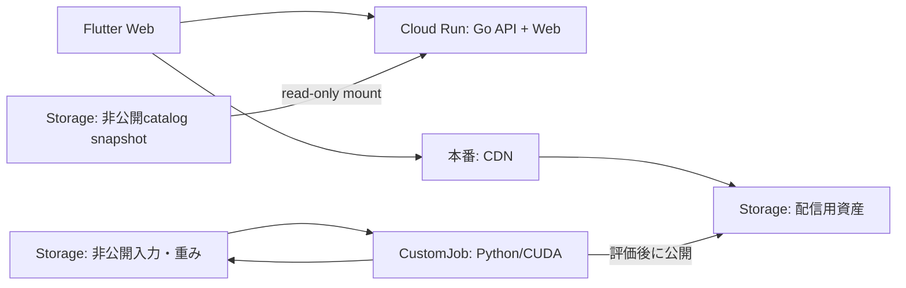

# インフラ構成案

配信構成の設計と [Terraform のコード準備](../infra/gcp/README.md) を行う段階。将来の目標は 10 万同時視聴（CCU）。GoとFlutter WebをまとめたDockerイメージのローカル起動は確認したが、Terraformによる実環境の作成、Cloud Runへの実配備、容量・quota・費用の検証は未実施である。[課題一覧](https://github.com/Hosi121/rangle/issues/20)

## 推奨する構成

Go APIとFlutter Webの静的成果物を1つのHTTPコンテナにまとめ、Cloud Runを実行先の候補とする。本番の大きな版付き資産はCDNとCloud Storageから取得し、Python/CUDAの再構成は有限のCustomJobへ分ける。

配信（data plane）、Go APIの制御（control plane）、GPU生成（generation plane）を分離する。生成済み資産を共有し端末で描画するため、同時視聴者数に合わせて専用サーバーGPUを増やす構成にしない。

ローカル/MVPではアプリを1サービスに抑え、Storage直接取得で成立を確認してよい。本番のGo APIは単一インスタンスへ状態を閉じず水平分散し、資産の全バイトを中継しない。UIの独立したリリースが必要になったら配信先を分ける。現在の `rangle-server` はWeb・フィードAPI・版付き資産を提供し、取得先originの設定で大容量配信を分離できる。PORT環境変数による待受けとGo・Flutter Webのコンテナ化に対応し、内蔵デモのローカル起動を確認した。Cloud Runへの実配備は後続とする。[APIと配信の契約](api-delivery.md)、[Dockerの手順](docker.md)

## 可搬性の境界

| 共通に保つもの | 実行環境に閉じるもの |
| --- | --- |
| Go/WebのOCIコンテナ、HTTP、ヘルスチェック | Cloud Run、IAM、スケール設定 |
| 資産の論理path、版、manifest、チェックサム | bucket、配信origin、CORS、認証 |
| Python/CUDAコンテナ、CLI引数、入力・出力の形式 | ジョブ投入・状態照会、GPUの種類、Storageへの転送 |

ABRや描画処理へクラウドSDKを広げず、実行先・取得元の接続部分を分ける。Cloud Runの `PORT` と待受け条件に合わせ、永続データはStorageに保存する。CUDAコンテナのGPU・driver適合は実機で確認する。[Cloud Runの実行契約](https://docs.cloud.google.com/run/docs/container-contract)、[CustomJob](https://docs.cloud.google.com/vertex-ai/docs/training/create-custom-job)

CDNを省く判断はローカル/MVPに限定し、数万同時視聴を目指す本番配信にはCDNとorigin保護を含める。Cloud CDNは外部Application Load Balancerとbackend bucketを伴うため、これらはprovider固有の設定としてIaCに閉じる。常駐GPU、GKE、ワークフロー基盤は現時点の必須構成にしない。[Cloud CDNの構成](https://docs.cloud.google.com/cdn/docs/setting-up-cdn-with-bucket)

origin保護では、immutable revisionを含むcache keyとCache-Control、同じkeyへのcache fill集約、originへの直接アクセスの公開範囲を設計する。キャッシュが冷たい状態や人気の集中でも、origin帯域・RPSが許容範囲かを確認する。CDNが常にhitすると仮定しない。[Cloud CDNのキャッシュとrequest collapsing](https://docs.cloud.google.com/cdn/docs/caching)

APIのconcurrency・最大インスタンス数、依存先の容量、配信とGPUのquota・region・費用上限は別途確定し、[段階的な容量検証](technology-selection.md#同時視聴の容量検証計画)で達成を判断する。[Cloud Runのautoscaling](https://docs.cloud.google.com/run/docs/about-instance-autoscaling)

## IaCの構成

HCL、Terraform 1.17.1、Google provider 8.10.0 に固定した。[infra/gcp](../infra/gcp/README.md) は state bootstrap、stg/main の独立 root、小さな GCP 専用 module で構成する。アプリの可搬性と、Google固有resourceを別クラウドへ移植する作業は区別する。

- `stg`・`main`は別root・別state・別実行identityにする。CLI workspaceの切替だけで隔離しない。
- stateは非公開の専用Storageに置き、lockとObject Versioningを使う。state用bucketの初期作成はbootstrapとして分ける。
- CLI・providerの版と lock file を管理する。Cloud Run は Go+Web を維持し、別 media hostname を CDN の backend bucket へ割り当てる。`/` landing、`/demo/*`、root API は app へ渡し、版付き media の path を維持する。image は [PR #19](https://github.com/Hosi121/rangle/pull/19) と [PR #38](https://github.com/Hosi121/rangle/pull/38) の機能を含む必要がある。
- 公開許諾済み media 専用 bucket、非公開 catalog、非公開入力、state を分離する。media origin は private bucket access と HTTPS-LB cache-fill SA で CDN から読み、匿名の直接 GCS 取得を許さない。署名 URL 不要の公開再生はこの IAM 接続を前提とする。
- catalog は readonly GCS mount の内容 SHA256 を含む不変 path を revision に固定する。FUSE の制約から catalog bucket だけ Object Versioning を無効にする。初回は `application=null` で storage/media edge を作り、検証済み snapshot の配置後に Cloud Run を追加する。データ配置や publisher は IaC の実行に含めない。
- CI認証はOIDC/WIFを候補とし、repositoryの数値 ID・owner ID と ref を制限する。WIF 作成、自動 apply、GPUジョブの実行は今回含めない。

根拠: [Googleのroot-module指針](https://docs.cloud.google.com/docs/terraform/best-practices/root-modules)、[Terraform GCS backend](https://developer.hashicorp.com/terraform/language/backend/gcs)、[private bucket access](https://docs.cloud.google.com/cdn/docs/configure-private-bucket-access)、[Cloud Run GCS mount](https://docs.cloud.google.com/run/docs/configuring/services/cloud-storage-volume-mounts)、[FUSE の制約](https://docs.cloud.google.com/storage/docs/cloud-storage-fuse/overview#limitations)、[CI向けWIF](https://docs.cloud.google.com/iam/docs/workload-identity-federation-with-deployment-pipelines)。

## 実配備前に決めること

実 project、region、quota、公開する資産、費用・GPU時間・ジョブ並列数の上限、DNS・state・実行権限の管理者を決める。これらは必須入力と架空の例に分離しており、コード準備のために実環境値は必要ない。

容量検証の実行予算と中止条件も別途定める。ローカルでのコンテナ起動と、Cloud Runでの起動可否、配信性能、GPU互換性、費用の検証は区別する。Cloud Runでの動作と大規模配信性能は未検証として扱う。

静的検証と mock plan の結果・初回配備順・保持と復帰の条件は [IaC README](../infra/gcp/README.md#ローカル検証) に記録する。