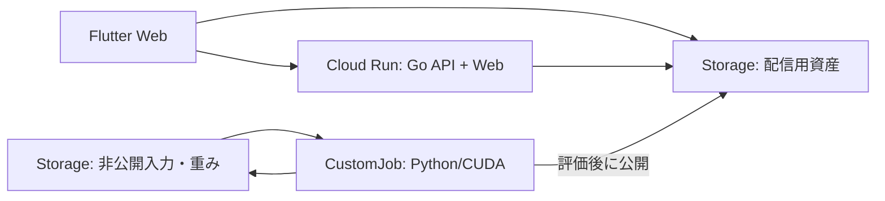

# 初期インフラ構成案

調査段階の提案。クラウド資源の作成・起動は行っていない。

## 推奨する構成

Go APIとFlutter Webの静的成果物を1つのHTTPコンテナにまとめ、Cloud Runを実行先の候補とする。大きな版付き資産はCloud Storageから直接取得し、Python/CUDAの再構成は有限のCustomJobへ分ける。

初期の常設アプリを1サービスに抑え、UIとAPIを一緒に更新する。UIの独立したリリースが必要になったら配信先を分ける。現状の `rangle-dev` はローカル確認用であり、クラウド用HTTP入口と静的配信は後続の実装になる。

## 可搬性の境界

| 共通に保つもの | 実行環境に閉じるもの |
| --- | --- |
| Go/WebのOCIコンテナ、HTTP、ヘルスチェック | Cloud Run、IAM、スケール設定 |
| 資産の論理path、版、manifest、チェックサム | bucket、配信origin、CORS、認証 |
| Python/CUDAコンテナ、CLI引数、入力・出力の形式 | ジョブ投入・状態照会、GPUの種類、Storageへの転送 |

ABRや描画処理へクラウドSDKを広げず、実行先・取得元の接続部分を分ける。Cloud Runの `PORT` と待受け条件に合わせ、永続データはStorageに保存する。CUDAコンテナのGPU・driver適合は実機で確認する。[Cloud Runの実行契約](https://docs.cloud.google.com/run/docs/container-contract)、[CustomJob](https://docs.cloud.google.com/vertex-ai/docs/training/create-custom-job)

Cloud CDNは外部Application Load Balancerとbackend bucketを伴う。初期はStorageのHTTPSオブジェクト取得から始め、取得時間・転送量・費用の実測からCDNを判断する。常駐GPU、GKE、ワークフロー基盤も現時点の必須構成にはしない。[Cloud CDNの構成](https://docs.cloud.google.com/cdn/docs/setting-up-cdn-with-bucket)

## IaCの分割案

HCLとGoogle providerを候補とし、実装前にTerraformかOpenTofuの一方へ固定する。アプリの可搬性と、Google固有resourceを別クラウドへ移植する作業は区別する。

- `stg`・`main`は別root・別state・別実行identityにする。CLI workspaceの切替だけで隔離しない。
- stateは非公開の専用Storageに置き、lockとObject Versioningを使う。state用bucketの初期作成はbootstrapとして分ける。
- CLI・providerの版を固定し、lock fileを管理する。最初から汎用クラウドmoduleを作らない。
- CI認証はOIDC/WIFを候補とし、repositoryとrefを制限する。GPUジョブの実行は明示的な別操作にし、IaC適用で学習を起動しない。

根拠: [Googleのroot-module指針](https://docs.cloud.google.com/docs/terraform/best-practices/root-modules)、[Terraform GCS backend](https://developer.hashicorp.com/terraform/language/backend/gcs)、[OpenTofu GCS backend](https://opentofu.org/docs/language/settings/backends/gcs/)、[CI向けWIF](https://docs.cloud.google.com/iam/docs/workload-identity-federation-with-deployment-pipelines)。

## 実装前に決めること

project、region、公開する資産、費用・GPU時間の上限、stateと実行権限の管理者を決める。現在は起動可否、配信性能、GPU互換性、費用を未検証として扱う。
