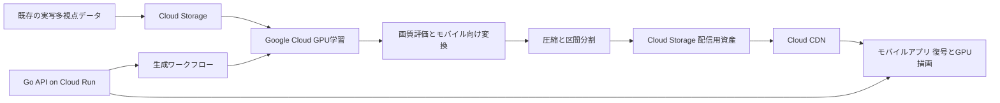

# rangle 企画書 草案

rangleは、replayとangleを組み合わせた造語。スポーツの決定的瞬間を、スマートフォンの縦型フィードで発見し、自分で時間と視点を動かして見返せるプラットフォームを作る。実写から再構成した動的なGaussian Splattingのシーンを、クラウドで生成・圧縮し、モバイル端末で受信・復号・描画する。

ハッカソンでは、既存の実写スポーツデータセットを使い、素材の取り込みから自由視点での視聴までをつなぐ。技術上の中心は、動的シーンの再構成と、モバイル向けの圧縮・配信・描画の統合に置く。

配信にはAdaptive Bitrate Streamingを中心とした一般的な最適化を取り入れる。品質別の資産、区間分割、帯域推定、バッファ制御、キャッシュ、先読みを組み合わせ、4DGSの復号と端末資源にも合わせる。[ABRと配信最適化の調査](streaming-research.md) に採用方針と一次資料をまとめる。

想定読者はチームメンバーと審査員。対象ユーザー、競技、数値目標、具体的な採用技術は、以下に示す提案を起点に決める。技術選定の根拠と比較候補は [技術選定案](technology-selection.md) にまとめる。

## 共有済みの方針

- スポーツのハイライトを、ショート動画のフィードのように楽しめること。
- 実写を基にしたシーンで、視聴者自身が視点を操作できること。
- モノレポで開発し、Goを使う予定であること。
- クラウドとMLを深く扱い、4DGSの圧縮・高速化・配信も技術テーマにすること。
- 素材は既存のデータセットを利用し、自前のスポーツ撮影を前提にしないこと。
- モバイル端末の計算資源を使うアプリを重視すること。

## 対象ユーザーと課題の仮説

最初の対象を、スポーツのハイライトを見るライトファンとする。「すごいプレーだったことは分かるが、なぜ成功したのか、別の位置からはどう見えていたのかまでは分からない」という場面を想定する。

解決したい課題は、撮影された一方向の映像では見つけにくい、位置関係や動きの発見を、自分の操作で行えるようにすること。ハイライトとの出会いを手軽に保ちながら、気になった瞬間には深く見返せる体験を提案する。

社会課題との接続は「競技知識が少ない人にも、プレーを理解し楽しむ入口を広げる」と置く。この効果は仮説であり、通常の動画との比較で確かめる。データセットの練習・実験場面だけで、実際の試合の戦術理解に有効だとは結論しない。

## 提供する体験

1. アプリを開くと、短いスポーツ映像が縦型フィードで再生される。
2. 気になった場面で「視点を動かす」を選ぶ。
3. 時間を止め、横方向のドラッグで被写体の周囲を見る。
4. 別の角度で再生し、動きや位置関係を見返す。
5. 上下のスワイプで次のハイライトへ進む。

フィード操作と視点操作はモードを分け、誤操作を減らす。最初の版では、制作側が設定した見やすい開始視点と、再構成品質を確認できた操作範囲を用意する。

ここでの「追体験」は、同じ出来事を自分の選んだ位置・時刻から見返すことと定義する。選手本人の視野や心理まで再現するという意味は持たせない。「実写」は撮影映像を基に再構成した外観を意味し、新しい視点の画像はレンダリングによって生成する。

## デモ素材

第一候補は、VRU BasketballのGuangzhouシーンとする。公開説明では、実写のバスケットボールを36視点で撮影し、`gz` と `dg` は1080p・250フレーム・約10秒で構成される。評価用の視点も指定されている。最初は `gz` の短区間で成立性を確かめ、再構成とモバイル再生がつながってからハイライトの長さを広げる。[データセット説明](https://huggingface.co/datasets/BestWJH/VRU_Basketball/blob/main/README.md)

ハイライトは既存シーンから選定する。複数クリップが同一シーン由来である場合は、そのことが分かる形でデモする。公式戦や複数競技のサービス実績として見せることはしない。

データセットと学習モデルの利用条件は別々に扱う。VRUの公開カードにはCC BY 4.0と記載されている一方、候補のLocalDyGSのコードには研究・評価用途の制限がある。公開する成果物の範囲を確認し、出典と必要なライセンス表示を付ける。[VRUの公開カード](https://huggingface.co/datasets/BestWJH/VRU_Basketball)、[LocalDyGSのライセンス](https://github.com/WuJH2001/LocalDyGS/blob/main/LICENSE)

## 技術構成の提案

学習はクラウド、視点を変えながらの描画は端末で行う構成を第一候補にする。視聴中のカメラ操作を端末内で処理できる構成を狙う。ただし、描画速度、通信量、発熱が目標内に収まるかは実機で判断する。

GoはフィードAPI、コンテンツ管理、生成ジョブの受付、配信マニフェストの提供を担当する。ML処理はPythonとGPU向け実装を使い、モバイルの描画処理には専用のGPU実装を用意する。Goを使う理由は、この非同期な生成処理とネットワーク処理を管理する役割にある。GoだけでMLやGPU描画まで統一する構成は採らない。

Google技術は、GPU学習、資産保存、API運用、配信、Android上の描画で中核を担う。Google CloudのCustomJobはカスタムコンテナと計算資源を指定する学習ジョブを提供し、Cloud RunはGoのアプリケーションを実行できる。Cloud CDNにはCloud Storageをバックエンドにした構成がある。[CustomJob](https://docs.cloud.google.com/vertex-ai/docs/training/create-custom-job)、[Cloud Run](https://docs.cloud.google.com/run/docs/overview/what-is-cloud-run)、[Cloud CDN](https://docs.cloud.google.com/cdn/docs/setting-up-cdn-with-bucket)

## 技術的に挑戦すること

### 動的シーンの再構成

多視点映像から、時間と視点を変えて描画できるシーンを学習する。まず既存モデルを再現し、その出力を基準として圧縮・高速化を評価する。

初期候補はVRUの処理手順が公開されているLocalDyGSとする。これは特定の「4D Gaussian Splatting」論文の再現とは区別する。本企画では、時間とともに変わるGaussian表現を扱う技術群として4DGSという語を使い、実際に使った手法名を成果物に明記する。

### 圧縮と配信

圧縮率だけを最適化すると、ボールや手足などプレーの理解に必要な部分を失う可能性がある。画質と動きの見え方を守りながら、転送量と端末メモリを下げることを目標にする。

最初は属性の量子化、時間区間ごとの分割、品質別の資産生成に取り組む。時間方向の差分圧縮、学習によるGaussianの削減、対象物の重要度を反映した圧縮は、その次の候補とする。各手法を単独で比較し、改善が確認できたものを組み合わせる。

配信制御では、帯域とバッファに応じて品質を選ぶABRを基本にする。切り替え先の初期化費用、展開後メモリ、復号時間も考慮し、同じ時間軸を持つ独立区間の境界で切り替える。通常動画のプレビューとGaussian資産は、それぞれの復号方式に合わせて扱う。

4DGSの圧縮・配信には先行研究がある。GIFStreamは時間依存の特徴ストリームを用いた圧縮を扱い、Fraunhofer HHIは既存の動画コーデックを使った動的Gaussianの復号を実演している。これらを比較・参照し、独自の発明であるとは主張しない。[GIFStream](https://github.com/XDimLab/GIFStream)、[Fraunhofer HHIのデモ](https://fraunhoferhhi.github.io/CodecGSDemo/)

### モバイルでの復号と描画

Androidネイティブアプリを最初の候補とし、UIと描画エンジンを分ける。GPU描画、復号、メモリ管理をまとめて計測し、端末に合わせて品質を選択する。

ブラウザでも対応端末ではWebGPUを利用できるため、ネイティブでなければGPUを使えないわけではない。ネイティブ採用の狙いは、GPU資源、メモリ転送、OSの性能情報を使った最適化を進めやすくすることに置く。AndroidにはVulkanと、熱・性能状態に対応するADPFがある。速度上の優位は採用前の実測で確認する。[AndroidのWebGPU対応](https://developer.chrome.com/blog/new-in-webgpu-121)、[Vulkan](https://developer.android.com/games/develop/vulkan/overview)、[ADPF](https://developer.android.com/games/optimize/adpf)

## ハッカソンでの完成範囲

| 区分 | 内容 |
| --- | --- |
| 一連の体験 | フィード、再生、一時停止、視点操作、次の動画への移動 |
| ML | 既存の実写データの短区間をクラウドで再構成し、画質を評価 |
| 配信 | 圧縮資産の生成、クラウド保存、区間単位の取得 |
| モバイル | 実機上での復号、動的シーン描画、操作と画面の追従 |
| 技術の証拠 | 圧縮前後の画質・容量・開始時間・描画時間・メモリの比較 |
| 再現性 | 使用データ、モデルの版、設定、実行手順、制約を提出資料に記載 |

帯域に応じた品質選択は配信基盤の中心に置く。追加の挑戦は、圧縮を考慮した学習、視点に応じた取得優先度、動画用ハードウェアデコーダーの活用とする。ライブ配信、一般投稿者の撮影支援、推薦モデル、複数OSへの同時展開は、最初の完成範囲から外す。

生成処理は事前実行を認める。ピッチ中に学習完了を待つ構成にせず、実行記録と生成された資産の対応を示す。視聴デモは実際の端末描画で行う。

## 評価方法

| 評価したいこと | 比較と観測方法 |
| --- | --- |
| 見返す体験の価値 | 同じプレーを通常動画と自由視点で提示し、発見、理解、再視聴意向、操作上の困難を確認 |
| 再構成品質 | 学習から除外したカメラ画像と比較。全体と人物・ボールの領域を確認 |
| 圧縮の効果 | 同じ区間・時刻・視点で、容量とPSNR・SSIM等を比較。小さな対象の消失も目視確認 |
| フィードの軽快さ | 表示、プレビュー再生、視点操作可能になる時点を別々に計測 |
| モバイルの安定性 | CPU/GPU時間、フレーム時間の分布、ピークメモリ、連続利用時の熱状態を記録 |
| クラウド運用 | 入力から公開までの所要時間、GPU実行時間、失敗と再実行、費用を記録 |

数値目標は技術選定案に仮置きし、初期計測と予算を基に確定する。速度改善のために対象範囲・画質・端末を変える場合は、その変更を明示して判断する。

## 審査項目への対応

| 審査軸 | 示すもの |
| --- | --- |
| Google技術の活用 | Google Cloudでの再構成・資産生成・配信と、AndroidのGPU描画。各技術の担当要件を説明 |
| プロダクトの完成度 | 発見から視点操作までの実機デモ。生成処理の状態管理とデータ形式の版管理 |
| 社会課題への解決力 | 誰が何を理解しにくいかを具体化し、通常映像との比較から有効性と限界を示す |
| ピッチの構成と説明力 | 同じ瞬間を別角度から見る体験を先に提示し、それを可能にするML・圧縮・配信の証拠を続ける |

「世界初」「他には存在しない」は現時点で主張しない。差別化の仮説は、スポーツの短いハイライトを、自分の視点で見返せる体験と、その体験をモバイルに届ける技術を一体で作ることに置く。

## 開発前に決める条件

次の段階では、対象スマートフォン、開発期限と人数、GPU実験の時間・費用上限を確定する。最初の検証単位は一つのデータセットの短区間とし、再構成からモバイル描画までがつながるかを確認する。

特に重要なのは、学習モデルの時間変化と視点依存の見た目を、端末で扱える形式へ移せるかという接続部分である。ここが成立しなければ、配信の大規模化に進まず、表現方式とモデルの組み合わせを見直す。
