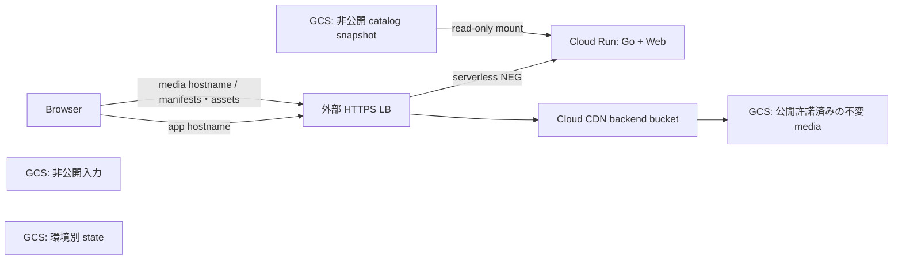

# GCP 配信基盤の Terraform

コード準備とローカル検証までの構成。実 project への接続、API 有効化、IAM 変更、apply、データ公開は実施していない。10 万同時視聴は将来の検証対象で、ここに性能・quota・費用の達成証拠はない。[設計](../../docs/infrastructure-design.md)、[課題一覧 #20](https://github.com/Hosi121/rangle/issues/20)

## 管理単位

| root / module | 管理するもの |
| --- | --- |
| `bootstrap/` | stg/main 各専用の非公開 state bucket と、その既存実行 SA への state 権限。bootstrap 自身の state はローカル |
| `environments/stg/` | stg 専用 backend・実行 identity・設定 |
| `environments/main/` | main 専用 backend・実行 identity・設定 |
| `modules/platform/` | 新規 GCS bucket、Cloud Run、serverless NEG、Cloud CDN、外部 Application Load Balancer、HTTPS、各 resource の IAM |

Terraform **1.17.1** と `hashicorp/google` **8.10.0** に固定し、各 root と直接テストする module に `.terraform.lock.hcl` を管理する。2026-11-08 に [公式 CLI release API](https://api.releases.hashicorp.com/v1/releases/terraform/latest) と [公式 provider Registry API](https://registry.terraform.io/v1/providers/hashicorp/google) で stable を確認した。CLI の [公式 SHA256SUMS](https://releases.hashicorp.com/terraform/1.17.1/terraform_1.17.1_SHA256SUMS) と照合した Linux amd64 ZIP は `4638628058e71a55212b1c563712eac03b902128f40740f3dc8174df12135061`。provider は `init` 時に HashiCorp 署名を検証した。ユーザーの global CLI を更新する必要はない。[Terraform のインストール](https://developer.hashicorp.com/terraform/install)

## HTTP と公開境界



Web は API と同じ OCI image に保持する。app hostname の `/`、`/demo/*`、`/api/*`、`/healthz` は Go へそのまま渡し、LB で path を書き換えない。Go が広告する `-asset-origin` は別 media hostname に固定し、`/manifests/...`、`/assets/...` など元のルート path を維持して GCS object key へ対応させる。Flutter 自身の `/demo/assets/*` とも衝突しない。Go へ `-asset-root` / `-scene-dir` を渡さず、大容量 bytes を中継させない。静的 Web の独立リリースが必要になるまでは、`/demo` routing を持つ既存アプリに配信責務を残す。[配信契約](../../docs/api-delivery.md)

使用する image は [PR #19](https://github.com/Hosi121/rangle/pull/19) の OCI/外部待受けと、[PR #38](https://github.com/Hosi121/rangle/pull/38) の landing・`/demo` routing を含む必要がある。現在の基底 branch の image だけで動くと仮定しない。Web は `RANGLE_API_URL=/api/v1/clips` を使う public-feed build が必要で、研究サンプル・重み・UVG データを image や public bucket に含めない。Terraform は image を build / push しない。

media bucket も `public_access_prevention=enforced` とし、`allUsers` は付与しない。backend bucket 作成後に生成される `service-PROJECT_NUMBER@https-lb.iam.gserviceaccount.com` に、その bucket の `roles/storage.objectViewer` を付与する。これは Google の **private bucket access** による、署名 URL / cookie を要求しない公開配信である。bucket を private にするだけでは成立しない。直接の匿名 GCS 取得は拒否し、CDN/LB 経由の全 object は公開する。ここは視聴者認証や有料配信の仕組みではない。[公式 private bucket access](https://docs.cloud.google.com/cdn/docs/configure-private-bucket-access)、[cache-fill identity の設定](https://docs.cloud.google.com/cdn/docs/setting-up-cdn-with-bucket#make_your_cloud_storage_bucket_private)

private origin の公式設定に従い、media backend だけ `FORCE_CACHE_ALL` と明示 TTL を使う。`private` / `no-store` ではこの境界を守れないため、API、UI、catalog、入力をこの bucket へ混ぜない。dynamic compression、negative cache、stale serve は無効。cache key は path と `generation` query、`Origin` header を使い、他の query を content selection や認可に使わない。CORS は app origin の GET/HEAD と Range 応答で必要な header を設定する。実ブラウザの preflight、200/206/304/HEAD/416、ETag/hash、cold fill は [#32](https://github.com/Hosi121/rangle/issues/32) で実証する。[CDN caching](https://docs.cloud.google.com/cdn/docs/caching)、[GCS CORS](https://docs.cloud.google.com/storage/docs/cors-configurations)

Cloud Run は IAM invoker check を無効にして公開フィードを提供し、ingress を internal + load balancing に制限し、既定 `run.app` URL を無効にする。内部経路も許される設定であり、利用者認証の代替ではない。app backend に CDN は付けず、Go の API cache / error headers を保持する。HTTPS 側 URL map は `https_redirect=false`、HTTP 側だけ HTTPS redirect を有効にする。[公開アクセス](https://docs.cloud.google.com/run/docs/authenticating/public)、[ingress](https://docs.cloud.google.com/run/docs/securing/ingress)、[URL map provider contract](https://registry.terraform.io/providers/hashicorp/google/8.10.0/docs/resources/compute_url_map)

## catalog と公開工程

catalog 専用 bucket を read-only GCS volume として `/mnt/catalog` へ mount する。Go は `snapshots/<catalog_sha256>.json` を起動時に読み、revision ごとにその path を固定する。クラウド SDK は Go / Dart / ABR に追加しない。runtime SA の追加権限は **catalog bucket の objectViewer だけ**で、入力・state・media の writer にはしない。[Cloud Run mount](https://docs.cloud.google.com/run/docs/configuring/services/cloud-storage-volume-mounts)

FUSE は Object Versioning bucket を正式にサポートしないため、catalog bucket の versioning は無効とする。state、media、入力には有効にする。readonly mount は同名 object の更新を防がず、hash を path に含めても内容の照合自体は行わない。有限の publisher が実際の SHA256 と path を照合し、`ifGenerationMatch=0` で新規配置する必要がある。publisher の IAM は media/catalog の objectCreator + objectViewer で、上書き・削除権限を持たない。管理者も公開済み key を変更しない。[FUSE の制約](https://docs.cloud.google.com/storage/docs/cloud-storage-fuse/overview#limitations)

公開順は、許諾済み asset を新 revision に配置 → 参照先・サイズ・SHA256・codec・timeline・Content-Type・`Cache-Control: public, max-age=..., immutable, no-transform`・CORS を検証 → versioned manifest → 最後に catalog snapshot とする。GCS の ETag が Go の SHA256 ETag と一致するとは仮定しない。`Content-Encoding: gzip` による GCS 自動展開も避け、配信 bytes と hash を確認する。この publisher と rights gate は [#22](https://github.com/Hosi121/rangle/issues/22)、[#25](https://github.com/Hosi121/rangle/issues/25) の未実装範囲で、Terraform は object を一切配置しない。

## 設定と初回の順序

以下は**実配備を任された段階の手順**。この PR では実行していない。`.example` の project、domain、SA、digest、region、scale は架空・例示値で、推奨容量や費用上限ではない。

1. 実 project と numeric project number、region、DNS 管理権、quota、公開対象、配信量・期間・予算・中止条件を決める。既存の bootstrap / stg / main / publisher identity を用意し、stg/main の実行 SA と state bucket を別にする。別 project を推奨する。project、billing account、実行 SA 自体はこのコードで作らない。
2. `bootstrap/terraform.tfvars.example` を private な `.tfvars` に写し、必要権限を持つ既存 bootstrap identity の impersonation で state 専用 bucket を作る。bootstrap のローカル state は暗号化・アクセス制限された作業場所に保管する。公開・一般 asset bucket を backend に流用しない。
3. 各環境の backend example を private な `backend.tfbackend` に写し、環境専用 bucket / prefix / `impersonate_service_account` を指定する。同じ SA を `terraform_service_account` に設定する。GCS backend の native locking を使い、CLI workspace は `default` のままとする。
4. 環境 root で `application = null` の差分を確認して適用する。新規 media/catalog/input bucket、runtime SA、media edge を作り、Cloud Run、app route、app 用証明書は作らない。media DNS A record だけを出力先 IP に設定し、HTTPS 証明書の ACTIVE を確認する。app DNS はまだ設定しない。未一致ホストは media hostname へ redirect する。
5. publisher が検証済み media → manifest → `snapshots/<sha256>.json` を配置し、CDN 取得を検証する。snapshot は実 catalog file であり、dummy catalog や研究サンプルで代用しない。完了まで `application=null` を維持する。
6. 互換 image の immutable digest、実 catalog SHA256、image 内 Web directory、CPU/memory/concurrency/min/max/timeout を `application` に設定する。再度差分を確認して適用すると、Cloud Run、serverless NEG、app backend/host route と app 用証明書が追加される。app DNS を設定し、証明書と UI/API の HTTPS 到達を確認する。既存 media 証明書は維持する。

GCS backend 初期化の形は次のとおり。bootstrap 作成と対象環境の確認後にだけ実行する。[GCS backend と impersonation](https://developer.hashicorp.com/terraform/language/backend/gcs)

```sh
terraform -chdir=infra/gcp/environments/stg init -backend-config=backend.tfbackend
```

SA key は作らない。実行元には選定した SA の impersonation 権限が必要で、backend 側にも独立して指定する。将来の CI は [OIDC/WIF](https://docs.cloud.google.com/iam/docs/workload-identity-federation-with-deployment-pipelines) で repository **数値 ID / owner ID** と stg/main ref を制限し、環境別 SA へ接続する候補とする。この PR に WIF pool、鍵、GitHub secret、自動 apply workflow は含めない。

## 実行権限・費用・復帰

bootstrap identity は state project の API 有効化、bucket 作成・IAM 管理に限定する。各環境の既存 execution SA は対象 project の必要 API の有効化、Cloud Run と Compute LB/NEG/CDN、bucket とその IAM、runtime SA の作成・IAM 管理の権限が必要。runtime SA の `actAs` は module がその SA だけに `roles/iam.serviceAccountUser` を付与する。組織の権限設計で resource scope / custom role を詰め、Owner / Editor や組織全体への権限を既定にしない。Cloud Run service agent が image を pull できることも必要で、別 project の Artifact Registry 権限はここでは管理しない。これらの事前権限・org policy・API 利用可能性は実環境で未確認。

min/max、CPU/RAM、concurrency、timeout は `application` の必須値。有限 max だけで CDN egress や全請求額は止まらず、scale 設定も厳密な費用上限ではない。LB/IP/保存/ログは無要求でも課金し得る。FUSE の memory も含めた CPU/RAM 適合、quota、429/503 と retry、budget alert / 中止操作、cold/warm/人気集中の測定を配備前に用意する。[Cloud Run maximum instances](https://docs.cloud.google.com/run/docs/configuring/max-instances-limits)、[#24](https://github.com/Hosi121/rangle/issues/24)

公開済み media と catalog は自動削除しない。rollback で必要な版を保持し、storage 成長と費用は運用で管理する。state の非現行世代だけは「30 日経過かつ新しい世代が 20 以上」で削除する。全 bucket に 7 日 soft delete と `force_destroy=false` / `prevent_destroy=true`、Cloud Run に deletion protection を付ける。`prevent_destroy` は resource 定義を削除した場合まで保護しないため、bucket を消す差分を通常の更新へ混ぜない。

復帰は以前の image digest + catalog SHA256 を `application` に戻して差分適用する。新旧 instance / API cache で cursor が失効し得るため、先頭からの再取得を含む [#26](https://github.com/Hosi121/rangle/issues/26) の検証が残る。`application=null` は rollback 操作ではない。片付けでは DNS・入口を止め、Cloud Run の削除保護を明示的に解除し、保持すべき資産/state を退避したうえで、bucket 保護と残存 object の扱いを別変更として確認する。terraform destroy 一発で研究データや state を消す運用にはしない。

## ローカル検証

認証・GCP API・実 backend を使わず、provider 取得と静的/mock 検証だけを行う。

```sh
terraform fmt -check -recursive infra/gcp
terraform -chdir=infra/gcp/bootstrap init -backend=false -input=false -lockfile=readonly
terraform -chdir=infra/gcp/bootstrap validate
terraform -chdir=infra/gcp/bootstrap test
terraform -chdir=infra/gcp/environments/stg init -backend=false -input=false -lockfile=readonly
terraform -chdir=infra/gcp/environments/stg validate
terraform -chdir=infra/gcp/environments/main init -backend=false -input=false -lockfile=readonly
terraform -chdir=infra/gcp/environments/main validate
terraform -chdir=infra/gcp/modules/platform init -backend=false -input=false -lockfile=readonly
terraform -chdir=infra/gcp/modules/platform validate
terraform -chdir=infra/gcp/modules/platform test
```

2026-11-08: 上記は成功。mock は bootstrap 2 ケース、platform 4 ケースで、全 run を `command=plan` としている。空 catalog での app 未作成、runtime の外部 asset-origin と readonly snapshot、private origin の cache-fill identity、環境 state 分離、公開/非公開 bucket の混同・mutable image tag の拒否を確認した。mock は Google API の resource 間制約を再現しない。実 ADC を使う plan/apply、実起動、権限、DNS/CDN、quota、費用、GPU、10 万 CCU は検証していない。
