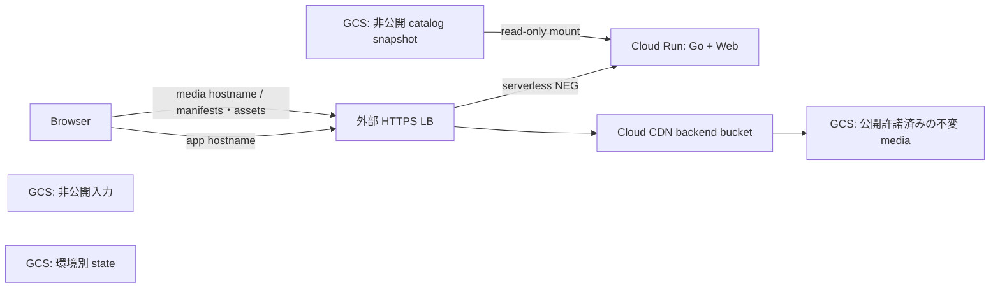

# GCP 配信基盤の Terraform

`environments/presentation/` は東京へ配備済み。汎用 `stg/main` rootは未配備の雛形である。[発表用配備手順](../../docs/stg-deployment.md)・[実装状況](../../docs/backend-status.md)。10万同時視聴の容量/quota/費用は未検証。

## 管理単位

| root / module | 管理対象 |
| --- | --- |
| `bootstrap/` | stg/main別のprivate state bucket・既存実行SAへの権限。自身のstateはlocal |
| `environments/stg/` / `main/` | 環境別backend/実行identity/設定 |
| `modules/platform/` | 新規GCS、Run、NEG、CDN、外部LB/HTTPS、resource IAM |
| `environments/presentation/` / `modules/presentation/` | 既存project内の期限/予算付きstg、専用state/identity/資源 |

## 配備済みの発表用stg

2026-11-10時点、`comin-up` / `asia-northeast1`。[公開アプリ](https://app.rangleplay.stream/demo/)と別hostのmedia CDNを配備し、HTTPS・モデルsize/SHA/Rangeを確認済み。

| 運用上の正本 | 内容 |
| --- | --- |
| [配備手順](../../docs/stg-deployment.md) | 小規模Run設定、予算/期限/guard、private stateとapply時の確認 |
| [生成基盤](../../docs/generation-infrastructure.md) | private managerへの権限分離、GPU/attempt枠、私的環境との分離 |
| [CI](../../docs/cicd.md) | stg専用WIF、digest固定候補・traffic昇格 |
| [クラウドLIVE](../../docs/cloud-live.md#権限と配備) | opt-inの前提・専用SA/prefix権限。[GCS置換](https://docs.cloud.google.com/storage/docs/json_api/v1/objects/insert)のdeleteは可変pointerだけに許可 |

LIVE実績は[ライブ処理](../../docs/live-training.md)。IaCの有効化だけで起動/遅延/追加attemptを保証しない。

Terraform **1.17.1** / Google **8.10.0** と各root・直接テストmoduleのlockを固定。2026-11-08に[CLI API](https://api.releases.hashicorp.com/v1/releases/terraform/latest)・[Registry](https://registry.terraform.io/v1/providers/hashicorp/google)のstable、[公式SHA](https://releases.hashicorp.com/terraform/1.17.1/terraform_1.17.1_SHA256SUMS)・provider署名を検証済み。global CLI更新は不要。[install](https://developer.hashicorp.com/terraform/install)

以下は主に**汎用stg/main**の契約と初回手順。presentationの実配備と混同しない。

## HTTP と公開境界



Web/APIは同じOCI imageで、appの `/`・`/demo/*`・`/api/*`・`/healthz` を無変換でGoへ渡す。mediaのroot pathはGCS keyへ対応し、Flutter assetsと衝突させない。Goへ `-asset-root` / `-scene-dir` を渡さない。[配信契約](../../docs/api-delivery.md)

imageは[OCI対応 #19](https://github.com/Hosi121/rangle/pull/19)・[landing/demo #38](https://github.com/Hosi121/rangle/pull/38)、Webは `RANGLE_API_URL=/api/v1/clips` を必要とする。Terraformはbuild/pushしない。研究sample/重み/UVGをimageや公開領域へ含めない。

mediaはPAP enforced・匿名IAMなし。backend作成後の `service-PROJECT_NUMBER@https-lb.iam.gserviceaccount.com` へそのbucketのobjectViewerを付ける。GCS匿名直通は拒否しつつ、CDN/LB経由の全objectは署名なし公開となる。視聴者認証は提供しない。[private bucket access](https://docs.cloud.google.com/cdn/docs/configure-private-bucket-access)、[cache-fill IAM](https://docs.cloud.google.com/cdn/docs/setting-up-cdn-with-bucket#make_your_cloud_storage_bucket_private)

| 汎用platformの設定 | 契約 |
| --- | --- |
| media cache | `FORCE_CACHE_ALL` と明示TTL。dynamic compression/negative cache/stale serveなし。private/no-storeに境界保護を依存しない |
| cache key / CORS | path・`generation` query・`Origin` header。CORSはapp originのGET/HEAD・Range用header。他queryを選択/認可に使わない |
| 公開Run | invoker check無効、internal＋LB ingress、既定URI無効。内部経路と利用者認証は別。presentationはGoogle-managed caller向けURIを維持 |
| app backend | CDNなしでGoのcache/error headerを保持。HTTPS mapは `https_redirect=false`、HTTPだけHTTPS redirect |

[CDN cache](https://docs.cloud.google.com/cdn/docs/caching)、[GCS CORS](https://docs.cloud.google.com/storage/docs/cors-configurations)、[Run公開](https://docs.cloud.google.com/run/docs/authenticating/public)、[ingress](https://docs.cloud.google.com/run/docs/securing/ingress)、[URL map](https://registry.terraform.io/providers/hashicorp/google/8.10.0/docs/resources/compute_url_map)。汎用moduleの実browser preflight・200/206/304/HEAD/416・ETag/hash/cold fillは [#32](https://github.com/Hosi121/rangle/issues/32) の検証対象。

## catalog と公開工程

catalog専用bucketを `/mnt/catalog` へreadonly mountし、起動時の `snapshots/<catalog_sha256>.json` をrevisionごとに固定する。汎用runtimeの追加権限はcatalog objectViewerだけで、input/state/media writerにしない。Go/Dart/ABRへcloud SDKは追加しない。[mount](https://docs.cloud.google.com/run/docs/configuring/services/cloud-storage-volume-mounts)

FUSE制約でcatalogだけversioning無効、state/media/inputは有効。readonly/hash pathだけでは内容不変を保証しないため、publisherが実SHAとpathを照合して `ifGenerationMatch=0` で新規作成する。publisherはmedia/catalogのobjectCreator＋Viewerだけ、管理者も公開keyを更新しない。[FUSE制約](https://docs.cloud.google.com/storage/docs/cloud-storage-fuse/overview#limitations)

公開順は **許諾済asset→versioned manifest→catalog snapshot**。参照・size/SHA/codec/timeline/Content-Type/cache/CORSを検証する。ETagをSHAと見なさず、Content-Encoding変換と実bytesを区別し、HTTP immutable hintだけに頼らない。Terraformはobjectを置かない。[publisher #22](https://github.com/Hosi121/rangle/issues/22)、[来歴gate #25](https://github.com/Hosi121/rangle/issues/25)

## 設定と初回の順序

汎用rootは未配備。exampleのproject/domain/SA/digest/region/scaleは架空値で、推奨容量/費用上限ではない。

1. project/number・region・DNS/quota・公開対象・配信量/期間/予算/中止条件を決める。既存bootstrap/stg/main/publisher identityと環境別SA/stateを用意する（別project推奨）。project/billing/実行SA自体は作らない。
2. privateなbootstrap tfvarsを使い、既存identityのimpersonationで専用state bucketを作る。local stateは暗号化・アクセス制限下へ置く。
3. private backendへ専用bucket/prefix/`impersonate_service_account`、同SAを `terraform_service_account` に指定する。GCS native locking、workspaceは `default`。
4. `application=null` でbucket/SA/media edgeだけを作る。media DNSを設定してcertificate ACTIVEを待つ。未一致hostはmediaへredirectする。
5. publisherがmedia→manifest→実catalogを配置してCDN取得を検証する。dummy/研究sampleは使わず、完了までappはnull。
6. image digest・catalog SHA・Web directory・CPU/memory/concurrency/min/max/timeoutを設定してRun/NEG/app route・certificateを作る。app DNS/HTTPS/UI/APIを確認し、media証明書を維持する。

bootstrap/対象環境確認後のbackend初期化：[GCS backend/impersonation](https://developer.hashicorp.com/terraform/language/backend/gcs)

```sh
terraform -chdir=infra/gcp/environments/stg init -backend-config=backend.tfbackend
```

SA keyは作らず、実行元/backendへimpersonationを明示する。汎用rootにはWIF/secret/自動applyはない。将来CIは環境SAを分け、[OIDC/WIF](https://docs.cloud.google.com/iam/docs/workload-identity-federation-with-deployment-pipelines)を数値repository/owner・環境refへ制限する。

## 実行権限・費用・復帰

| identity | 必要権限・境界 |
| --- | --- |
| bootstrap | state projectのAPI有効化・bucket作成/IAM |
| execution SA | 対象projectの必要API、Run/LB/NEG/CDN、bucket/IAM、runtime SA/IAM。moduleは対象runtime SAだけへactAsを付与 |
| image pull | Run service agentの権限を確認。別project ARはこのmoduleの管理外 |

org policy/API利用可否・事前権限は汎用rootで未検証。resource scope/custom roleを詰め、Owner/Editorや組織全体権限を既定にしない。

scale必須値と有限maxは費用hard capではない。LB/IP/storage/logは無要求でも課金し得る。配備前にFUSE込みCPU/RAM/quota、429/503/retry、budget/中止操作、cold/warm/人気集中を確認する。[Run max](https://docs.cloud.google.com/run/docs/configuring/max-instances-limits)、[#24](https://github.com/Hosi121/rangle/issues/24)

公開media/catalogは自動削除せず、rollback用の版を保持する。state非現行世代だけ「30日経過かつ新世代20以上」で清掃。全bucketは7日soft delete・`force_destroy=false` / `prevent_destroy=true`、Runは削除保護。resource定義削除はprevent_destroyの保護外なので、通常更新へbucket削除を混ぜない。

汎用rootの復帰は以前のimage digest＋catalog SHAをappへ戻すplan/apply。`application=null` はrollbackではない。新旧instance/cacheによるcursor失効と先頭再取得は [#26](https://github.com/Hosi121/rangle/issues/26) の検証対象。presentation CIは[両serviceの実traffic復帰](../../docs/cicd.md#配備の流れ)を使い、DB/台帳は戻さない。

片付けはDNS/入口停止→保持asset/state退避→Run削除保護解除→bucket保護/残存objectの別確認で行う。一括destroyで研究データ/stateを削除しない。

## ローカル検証

認証・GCP API・実backendを使わず、provider取得と静的/mockだけを検証する。

```sh
terraform fmt -check -recursive infra/gcp
terraform -chdir=infra/gcp/bootstrap init -backend=false -input=false -lockfile=readonly
terraform -chdir=infra/gcp/bootstrap validate
terraform -chdir=infra/gcp/bootstrap test
terraform -chdir=infra/gcp/environments/stg init -backend=false -input=false -lockfile=readonly
terraform -chdir=infra/gcp/environments/stg validate
terraform -chdir=infra/gcp/environments/main init -backend=false -input=false -lockfile=readonly
terraform -chdir=infra/gcp/environments/main validate
terraform -chdir=infra/gcp/modules/platform init -backend=false -input=false -lockfile=readonly
terraform -chdir=infra/gcp/modules/platform validate
terraform -chdir=infra/gcp/modules/platform test
```

mockはbootstrap 2・platform 4ケース、すべて `command=plan`。空catalogでapp未作成、外部origin/readonly snapshot、private cache-fill、state分離、bucket混同/mutable image拒否を確認する。Google API間制約は再現せず、presentationの実plan/apply・起動・IAM・DNS/CDN/GPU証拠とは分ける。10万CCUは未検証。
